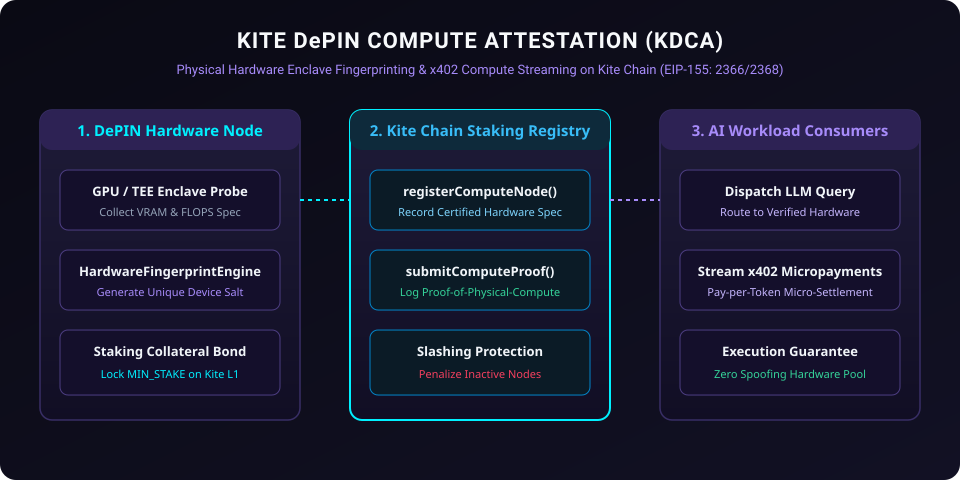

# Kite DePIN Compute Attestation (KDCA)

<p align="center">
  
</p>

[](LICENSE)
[](https://gokite.ai)
[](#depin-compute-mechanics)
[](https://www.typescriptlang.org)

**Kite DePIN Compute Attestation (KDCA)** is a decentralized physical infrastructure network (DePIN) verification protocol engineered specifically for **Kite Blockchain** (EIP-155: Chain IDs `2366` / `2368`).

It allows decentralized edge computing hardware (GPU clusters, NPU nodes, edge AI inference rigs) to prove physical hardware integrity (VRAM depth, FLOPS throughput, TEE enclave measurements), bond slashable staking deposits, and stream reward disbursements using Kite Chain's native **x402 micro-settlement rails**.

---

## ⚡ Core Capabilities

1. **Hardware Enclave Fingerprinting**: Validates cryptographic attestation reports (CPU/GPU TEE signatures) on-chain.
2. **Proof-of-Physical-Compute (PoPC)**: Periodic challenge-response tests ensuring nodes hold dedicated VRAM rather than spoofing synthetic responses.
3. **Automated Slashing Circuit**: Slashing malicious or dropping nodes who fail liveness and computation latency bounds.
4. **x402 Facilitator Streaming**: Continuous streaming micro-payouts for compute time delivered per second.

---

## 🛠 Smart Contracts & Client SDK

- **`contracts/KiteDePINComputeAttestation.sol`**: Solidity 0.8.24 smart contract:
  - `registerComputeNode(bytes32 hardwareFingerprint, uint256 vramMb, uint256 flopsTier)`
  - `submitComputeProof(bytes32 nodeId, bytes32 workloadHash, uint256 executionLatencyMs)`
  - `claimEarnedRewards(bytes32 nodeId)`
  - `slashNonCompliantNode(bytes32 nodeId, bytes fraudProof)`
- **`src/hardware-fingerprint.ts`**: TEE enclave signature and VRAM capacity validator.
- **`src/depin-client.ts`**: Kite Chain Viem/Ethers provider client with automated gas-free fee relayer dispatch.
- **`test/depin.test.ts`**: Comprehensive automated unit test suite.

---

## 🚀 Quick Start

### Installation

```bash
git clone https://github.com/circularmarke/kite-depin-compute-attestation.git
cd kite-depin-compute-attestation
npm install
npm test
```

---

## 📜 License

Licensed under the [Apache License, Version 2.0](LICENSE).
